**English** · [Português](./README.pt-BR.md)

## About me

Senior software developer with **8+ years of experience** building web and mobile products end to end, from the database to the UI: APIs, integrations, microservices, frontend and apps.

I've worked on e-commerce, enterprise systems, self-service platforms, CRM and ERP integrations, logistics, and AI-powered applications. Main stack: TypeScript, React, Next.js, Vue, Nuxt, React Native, Python and Rust.

## Open source contributions

- **Microsoft PowerToys**: [Add "remove duplicate PATH entries" action to Environment Variables](https://github.com/microsoft/PowerToys/pull/50585) (merged Sep 2026)
- **python/pymanager**, the official Python install manager for Windows: [Stream package extraction to bound peak memory usage](https://github.com/python/pymanager/pull/410) (merged Sep 2026)
- **Podman Desktop**: [Bulk stop action for containers](https://github.com/podman-desktop/podman-desktop/pull/18336) (merged Sep 2026)
- **Podman Desktop**: [Preserve disabled startup setting on Windows](https://github.com/podman-desktop/podman-desktop/pull/19104) (merged Oct 2026)

## Open source projects

- **[vitral](https://github.com/joaogabriel15/vitral)**: micro-frontends for any framework with zero host build config ([npm](https://www.npmjs.com/package/vitral))
- **[vpn-manager](https://github.com/joaogabriel15/vpn-manager)**: simple VPN manager in Rust, with FortiClient SSO on Linux
- **[adblocker](https://github.com/joaogabriel15/adblocker)**: Android ad and tracker blocker, no root, using a local DNS-only VPN

## Work highlights

- **[ArchPrompts](https://arch-prompts.com/)**: marketplace of prompts for software architecture
- **High-traffic e-commerce** with React, VTEX IO and GraphQL
- **Customer-service portals and mobile apps**
- **Integration APIs** connecting CRMs, ERPs and enterprise systems
- **Admin and logistics microservices** with FastAPI and RabbitMQ
- **Chatbots and smart self-service** with NLP
- **Offline-first apps**, biometrics and device integration

More work on my [portfolio](https://pacheco.dev.br).

## Contact

[pacheco.dev.br](https://pacheco.dev.br) · [LinkedIn](https://www.linkedin.com/in/pacheco-dev-br/) · [pacheco.code@gmail.com](mailto:pacheco.code@gmail.com)

The card is generated by <a href="./tools/gen_card.py"><code>tools/gen_card.py</code></a> from a portrait painted in the style of Van Gogh.
