[English](./README.md) · **Português**

## Sobre mim

Desenvolvedor de software sênior com mais de **8 anos de experiência** em soluções web e mobile, do banco de dados à interface: APIs, integrações, microsserviços, frontend e apps.

Já trabalhei com e-commerce, sistemas empresariais, plataformas de autoatendimento, integrações com CRMs e ERPs, logística e aplicações com inteligência artificial.

## Contribuições open source

- **Microsoft PowerToys**: [ação para remover entradas duplicadas do PATH no Environment Variables](https://github.com/microsoft/PowerToys/pull/50585) (aceito em set/2026)
- **python/pymanager**, o instalador oficial do Python para Windows: [extração de pacotes em streaming para limitar o pico de memória](https://github.com/python/pymanager/pull/410) (aceito em set/2026)
- **Podman Desktop**: [ação para parar vários containers de uma vez](https://github.com/podman-desktop/podman-desktop/pull/18336) (aceito em set/2026)
- **Podman Desktop**: [manter desativada a inicialização automática no Windows](https://github.com/podman-desktop/podman-desktop/pull/19104) (aceito em out/2026)

## Projetos open source

- **[vitral](https://github.com/joaogabriel15/vitral)**: micro-frontends com qualquer framework, sem configurar build no host ([npm](https://www.npmjs.com/package/vitral))
- **[vpn-manager](https://github.com/joaogabriel15/vpn-manager)**: gerenciador de VPN simples em Rust, com FortiClient SSO no Linux
- **[adblocker](https://github.com/joaogabriel15/adblocker)**: bloqueador de anúncios e rastreadores para Android, sem root

## Projetos e experiências

- **[ArchPrompts](https://arch-prompts.com/)** — marketplace de prompts para arquitetura de sistemas
- **E-commerce de alto tráfego** com React, VTEX IO e GraphQL
- **Portais e aplicativos mobile** para atendimento e serviços digitais
- **APIs de integração** entre CRMs, ERPs e sistemas corporativos
- **Microsserviços administrativos e logísticos** com FastAPI e RabbitMQ
- **Chatbots e autoatendimento inteligente** com NLP
- **Aplicações offline**, biometria e integração com dispositivos

Outros trabalhos no meu [portfólio](https://pacheco.dev.br).

## Contato

[pacheco.dev.br](https://pacheco.dev.br) · [LinkedIn](https://www.linkedin.com/in/pacheco-dev-br/) · [pacheco.code@gmail.com](mailto:pacheco.code@gmail.com)

O card é gerado por <a href="./tools/gen_card.py"><code>tools/gen_card.py</code></a> a partir de um retrato pintado no estilo de Van Gogh.
